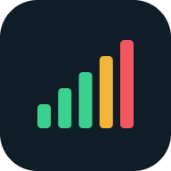

<p align="center"></p>

<h1 align="center">Open Noise Meter</h1>

<p align="center">
  Freier Schallpegelmesser für Smartphone und Laptop, direkt im Browser.<br>
  <strong><a href="https://smjol.github.io/open-noise-meter/">➜ App öffnen</a></strong>
</p>

[English version below](#english)

## Funktionen

- **Pegelmesser** mit Frequenzbewertung **A / C / Z** und Zeitbewertung **Fast / Slow / Impulse**
- **Leq, Lmax, Lmin, LCpeak**, Messdauer und Pegelverlauf (60 s, 5 min, ganze Messung)
- **Spektrum**: FFT mit logarithmischer Frequenzachse, Peak-Hold und dominanter Frequenz, **Terzbänder** (25 Hz–20 kHz) und **Spektrogramm**
- **Messung**: Zusammenfassung mit L10/L50/L90 und **Lärmdosis** (85 dB(A)/8 h), **CSV-Export** im Sekundenraster (Excel-tauglich), gespeicherte Messungen
- **Kalibrierung** gegen ein Referenzgerät, pro Gerät gespeichert
- Deutsch und Englisch, helles und dunkles Design
- **Installierbar** (PWA): „Zum Home-Bildschirm“ hinzufügen, funktioniert danach auch offline
- Keine Anmeldung, keine Werbung, kein Tracking. Das Audio wird nur lokal im Browser verarbeitet.

## Benutzung

1. **[App öffnen](https://smjol.github.io/open-noise-meter/)** und auf **Start** tippen, dann den Mikrofonzugriff erlauben.
2. Auf dem iPhone: in Safari **Teilen → Zum Home-Bildschirm**. Auf Android: Menü → **App installieren**.
3. Einmal **kalibrieren** (Einstellungen → Kalibrierung), sonst können die Werte um mehrere dB abweichen. Bewährte Offsets stehen in [CALIBRATION.md](CALIBRATION.md).

Testmodus ohne Mikrofon: `?demo=1000&level=-20` (Sinuston, Frequenz in Hz, Pegel in dBFS) oder `?demo=noise` an die Adresse anhängen.

> **Hinweis:** Ein Smartphone ist kein geeichtes Messgerät. Für verbindliche Messungen ein Schallpegelmessgerät der Klasse 1 oder 2 nach IEC 61672 verwenden.

## Technik

Reines HTML, CSS und JavaScript ohne Build-Schritt und ohne Abhängigkeiten.

| Datei | Aufgabe |
| --- | --- |
| `js/worklet/level-processor.js` | AudioWorklet: A/C/Z-Filter, Zeitbewertung, Leq, Peak, Min/Max |
| `js/dsp/weighting.js` | A- und C-Bewertung nach IEC 61672 als digitale Biquad-Kaskade (bilineare Transformation) |
| `js/dsp/bands.js` | Terzbänder, Kalibrierung der FFT-Werte, dominante Frequenz |
| `js/dsp/levels.js` | dB-Rechnung, Perzentile, Lärmdosis |
| `js/audio-engine.js` | Mikrofon bzw. Demo-Signal → AnalyserNode → Worklet |
| `js/app.js` | Oberfläche und Zustand |

Die Mikrofonverarbeitung (Echo-Unterdrückung, Rauschunterdrückung, automatische Verstärkung) wird abgeschaltet. Die A-Bewertung weicht bei 48 kHz bis 10 kHz um weniger als 0,4 dB von der Norm-Kurve ab.

### Lokal starten und testen

```bash
python -m http.server 8000
```

Dann <http://localhost:8000> öffnen. Die DSP-Tests laufen im Browser unter <http://localhost:8000/tests/>.

## Mitmachen

Issues und Pull Requests sind willkommen, besonders Kalibrierwerte für weitere Geräte in [CALIBRATION.md](CALIBRATION.md).

## Lizenz

[MIT](LICENSE)

---

<a id="english"></a>

## English

Free sound level meter for phones and laptops that runs in the browser. **[Open the app](https://smjol.github.io/open-noise-meter/)**

- Level meter with **A / C / Z** frequency weighting and **Fast / Slow / Impulse** time weighting
- **Leq, Lmax, Lmin, LCpeak**, duration and level history
- **Spectrum**: FFT with peak hold and dominant frequency, **third-octave bands** and **spectrogram**
- **Session** summary with L10/L50/L90 and **noise dose**, **CSV export** (1 s resolution), saved measurements
- Per-device **calibration** against a reference meter
- German and English UI, light and dark theme, installable PWA that works offline
- No account, no ads, no tracking. Audio never leaves the browser.

**Usage:** open the app, tap **Start** and allow microphone access. On iPhone use Safari → Share → **Add to Home Screen**. Calibrate once under Settings → Calibration; known offsets are collected in [CALIBRATION.md](CALIBRATION.md). Append `?demo=1000&level=-20` or `?demo=noise` to the URL to try it without a microphone.

> A smartphone is not a certified sound level meter. Use a class 1 or class 2 meter (IEC 61672) for binding measurements.

**Development:** plain HTML/CSS/JS with no build step. Run `python -m http.server 8000` and open <http://localhost:8000>; DSP tests run at `/tests/`.

Licensed under the [MIT License](LICENSE).
